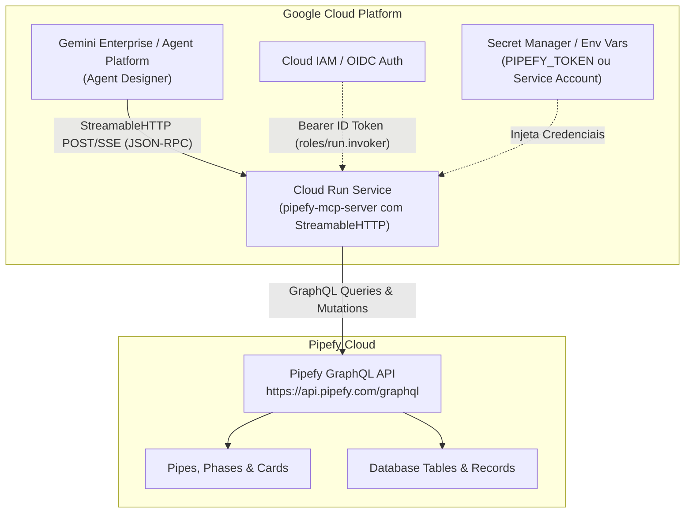

# Plano de Arquitetura e Implementação: Conectando Gemini Enterprise ao Pipefy via MCP

## 1. Goal Description
Conectar o **Gemini Enterprise** (Google Cloud / Vertex AI Agent Builder & Platform) ao **Pipefy** utilizando o padrão **Model Context Protocol (MCP)**, baseado no repositório oficial da Pipefy: [pipefy/ai-toolkit](https://github.com/pipefy/ai-toolkit).

A solução permitirá que os agentes de IA corporativos do Gemini Enterprise interajam com processos de negócio, consultando pipes, criando e atualizando cards, movimentando cards entre fases, inserindo comentários e manipulando registros de bancos de dados (tabelas) do Pipefy em linguagem natural.

---

## 2. Deep Research: Análise Técnica do `pipefy/ai-toolkit` e Gemini Enterprise

### 2.1 Requisitos do Gemini Enterprise para MCP
* **Transporte Obrigatório:** Suporta **exclusivamente `StreamableHTTP`** (JSON-RPC sobre HTTP streaming). O Gemini Enterprise **não** suporta o transporte legado SSE (Server-Sent Events antigo) nem `stdio` para conexões em nuvem.
* **Segurança e TLS:** O endpoint MCP deve ser HTTPS público com certificado emitido por Autoridade Certificadora (CA) pública confiável (suportado nativamente pelo Google Cloud Run).
* **Autenticação:** O Gemini Enterprise conecta-se via **Google Cloud IAM** (injetando token de serviço/OIDC para serviços no Cloud Run) ou **OAuth 2.0** com fluxo Authorization Code e redirecionamento para `https://vertexaisearch.cloud.google.com/oauth-redirect`.
* **Limite Recomendado de Ações:** O Google recomenda limitar a lista de ferramentas ativas a no máximo **100 ações** por data store para evitar degradação de contexto e alucinações de function calling.

### 2.2 Descobertas sobre o `pipefy/ai-toolkit`
O repositório oficial [`pipefy/ai-toolkit`](https://github.com/pipefy/ai-toolkit) é um monorepo Python moderno gerenciado com `uv` contendo:
* **`pipefy-mcp-server` (`packages/mcp`):** Servidor MCP baseado no SDK `mcp[cli]==2.0.*` com Starlette e Uvicorn.
* **Suporte Nativo a Streamable HTTP:** Possui a flag `--transport http` e `--profile remote` (`uvicorn` servindo Streamable HTTP na porta especificada por `$PORT` ou `--port`).
* **Autenticação Pipefy:**
  * **Service Account:** Variáveis `PIPEFY_SERVICE_ACCOUNT_CLIENT_ID` e `PIPEFY_SERVICE_ACCOUNT_CLIENT_SECRET`.
  * **Static Token:** Variável `PIPEFY_TOKEN` (Personal Access Token).
* **Controle de Superfície de Ferramentas (`PIPEFY_MCP_TOOLSETS`):**
  * O catálogo completo possui mais de 180 ferramentas.
  * O `pipefy-mcp-server` permite filtrar ferramentas por domínio via `PIPEFY_MCP_TOOLSETS` (ex.: `cards,pipes,tables`) ou utilizar o modo `power` (meta-ferramentas de busca de catálogo), garantindo total conformidade com a recomendação de <100 ferramentas do Gemini Enterprise.

---

## 3. Arquitetura da Solução



---

## 4. User Review Required

> [!IMPORTANT]
> **Modo de Autenticação com o Pipefy:**
> Recomendamos o uso de uma **Service Account do Pipefy** (gerada no painel de administração da sua empresa em *Company Settings -> Service Accounts*) com `CLIENT_ID` e `CLIENT_SECRET`, pois ela tem ciclo de vida corporativo e renovação automática de tokens via OAuth2 `client_credentials`. Alternativamente, pode-se usar um `PIPEFY_TOKEN` estático (Personal Access Token).

> [!TIP]
> **Hospedagem no Google Cloud Run:**
> Como o Gemini Enterprise opera no Google Cloud, publicar o container no **Cloud Run** garante latência mínima, TLS automático válido, escalabilidade automática (scale-to-zero para redução de custos) e autenticação IAM nativa com a conta de serviço do Gemini.

---

## 5. Proposed Changes (Arquivos do Repositório)

Estruturação do repositório local `mcp pipefy` para conter a receita de deploy, Dockerfile otimizado, wrapper de execução, configuração de toolsets e scripts de teste:

### [NEW] `Dockerfile`
Container Docker baseado em Python 3.11-slim e `uv`, instalando `pipefy-mcp-server` diretamente do PyPI (ou empacotando o toolkit) e configurando o ponto de entrada para:
```sh
pipefy-mcp-server --profile remote --transport http --host 0.0.0.0 --port $PORT
```

### [NEW] `docker-compose.yml`
Para execução e testes locais simulando o ambiente HTTP do Cloud Run.

### [NEW] `.env.example`
Exemplo de configuração com as variáveis:
- `PIPEFY_TOKEN` ou `PIPEFY_SERVICE_ACCOUNT_CLIENT_ID` e `PIPEFY_SERVICE_ACCOUNT_CLIENT_SECRET`
- `PIPEFY_MCP_TOOLSETS=pipes,cards,tables` (para adequação ao limite de ferramentas)
- `PORT=8080`
- `HOST=0.0.0.0`

### [NEW] `scripts/test_mcp_http.py`
Script cliente em Python que realiza handshake `initialize`, lista ferramentas (`tools/list`) e simula uma chamada de ferramenta contra o servidor StreamableHTTP local ou em nuvem.

### [NEW] `deploy_cloud_run.sh` / `deploy_cloud_run.ps1`
Script automatizado para build e deploy do serviço no Google Cloud Run configurando variáveis e permissões IAM.

### [NEW] `docs/GEMINI_ENTERPRISE_SETUP.md`
Guia passo a passo com telas e configurações no console do Gemini Enterprise (Agent Builder):
1. Criação do Data Store do tipo **Custom MCP Server**.
2. Configuração da URL (`https://<service-name>.run.app/mcp`).
3. Mapeamento das permissões IAM da Service Account do Gemini Enterprise (`roles/run.invoker`).
4. Ativação das ações no Agent Designer.

---

## 6. Verification Plan

### Testes Automatizados e Locais
1. **Subir container local:**
   - Iniciar o servidor com `docker build -t pipefy-mcp .` e rodar na porta 8080.
2. **Validação do Protocolo StreamableHTTP:**
   - Executar `python scripts/test_mcp_http.py http://localhost:8080/mcp`.
   - Verificar se as ferramentas do Pipefy são listadas com schemas válidos e dentro do limite recomendado.

### Validação no Cloud Run e Gemini Enterprise
1. **Deploy no Cloud Run:**
   - Obter a URL HTTPS pública gerenciada com certificado TLS válido.
2. **Registro no Gemini Enterprise:**
   - Cadastrar o endpoint no Gemini Enterprise Data Stores.
   - Verificar status **Active**.
3. **Teste do Agente:**
   - No Agent Designer ou no chat do Gemini Enterprise, executar:
     - *"Liste os pipes disponíveis no Pipefy."*
     - *"Mostre os cards na fase inicial do pipe [Nome do Pipe]."*
     - *"Crie um card de solicitação com título [Teste Gemini]."*
