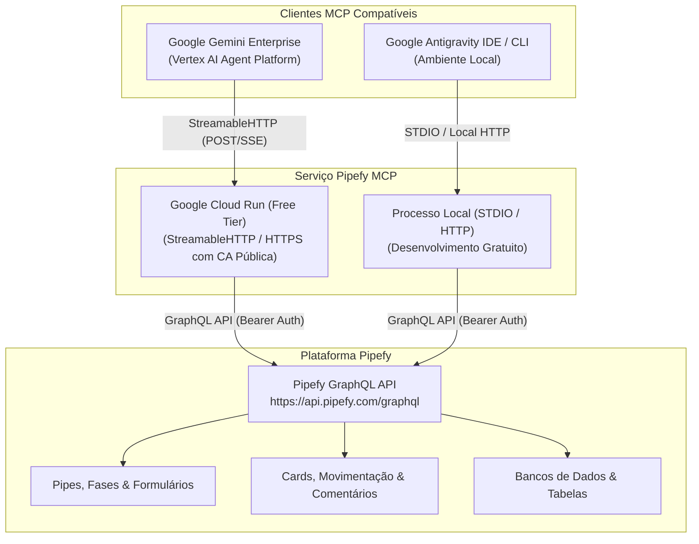

# Pipefy MCP Enterprise: Conexão Gemini Enterprise & Antigravity

[](https://www.python.org/)
[](https://modelcontextprotocol.io/)
[](https://cloud.google.com/run)
[](LICENSE)

Servidor corporativo e de desenvolvimento baseado no **Model Context Protocol (MCP)** para integrar agentes de IA (**Google Gemini Enterprise** e **Google Antigravity**) aos fluxos de trabalho e processos do **Pipefy**.

Construído sobre o kit oficial [`pipefy/ai-toolkit`](https://github.com/pipefy/ai-toolkit) e otimizado com arquitetura de **custo zero** (Google Cloud Run Free Tier com *scale-to-zero* e execução local).

---

## 🏗️ Arquitetura do Sistema



---

## 🌟 Principais Destaques

* **Conformidade Total com Gemini Enterprise:**
  * Transporte nativo **`StreamableHTTP`** sobre Starlette e Uvicorn.
  * Terminação HTTPS automática com certificado TLS emitido por CA pública confiável no Cloud Run.
  * Curadoria de ferramentas (`PIPEFY_MCP_TOOLSETS=cards,pipes,tables`) mantendo as ações ativas **abaixo do limite de 100 ferramentas** recomendado pela Google.
* **Integração Gratuita com o Antigravity:**
  * Suporte a modo `--stdio` para rodar localmente sem expor portas.
  * Capacidade de interagir com o Pipefy diretamente nas conversas da IDE.
* **Custo Zero de Infraestrutura:**
  * Otimizado para o tier gratuito do Cloud Run (até 2 milhões de requisições/mês, escala automática para zero instâncias quando inativo).
* **Segurança Corporativa:**
  * Suporte a Service Accounts do Pipefy (`client_credentials`) e Personal Access Tokens.
  * Credenciais injetadas por variáveis de ambiente ou Secret Manager, sem risco de vazamento em código.

---

## 🚀 Como Começar

### 1. Configurar Credenciais Locais
Copie o arquivo de exemplo de ambiente e preencha suas credenciais do Pipefy:
```bash
cp .env.example .env
```
Obtenha seu token em: [app.pipefy.com/tokens](https://app.pipefy.com/tokens) ou via Service Account em *Company Settings*.

### 2. Executar Localmente

#### Modo StreamableHTTP (para testes de API):
```bash
python -m src.run_server
# Servidor ouvindo em http://0.0.0.0:8080/mcp
```

#### Modo STDIO (para integração direta no Antigravity / Claude / Cursor):
```bash
python -m src.run_server --stdio
```

### 3. Validar a Conexão MCP
Execute o script de teste automatizado para validar o handshake JSON-RPC 2.0 e o limite de ferramentas:
```bash
python scripts/test_mcp_client.py http://localhost:8080/mcp
```

---

## ☁️ Deploy no Google Cloud Run (Free Tier)

Para publicar o servidor com certificado TLS válido para o Gemini Enterprise em um clique:

* **No Windows (PowerShell):**
  ```powershell
  .\deploy_cloud_run.ps1
  ```
* **No Linux / macOS (Bash):**
  ```bash
  chmod +x deploy_cloud_run.sh
  ./deploy_cloud_run.sh
  ```

---

## 📚 Guias Detalhados
* 📘 [Conectando ao Google Gemini Enterprise](docs/GEMINI_ENTERPRISE_SETUP.md)
* 📗 [Conectando ao Google Antigravity (Local Gratuito)](docs/ANTIGRAVITY_SETUP.md)
* 📋 [Plano de Arquitetura e Engenharia (PLAN.md)](PLAN.md)
* 🚦 [Contexto e Trilha Conductor](conductor/index.md)
